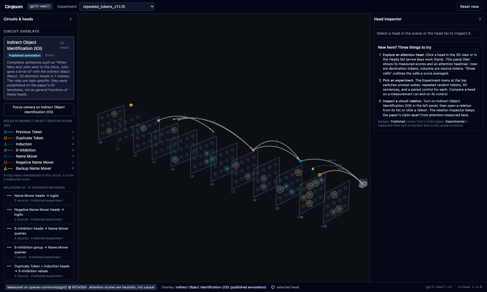
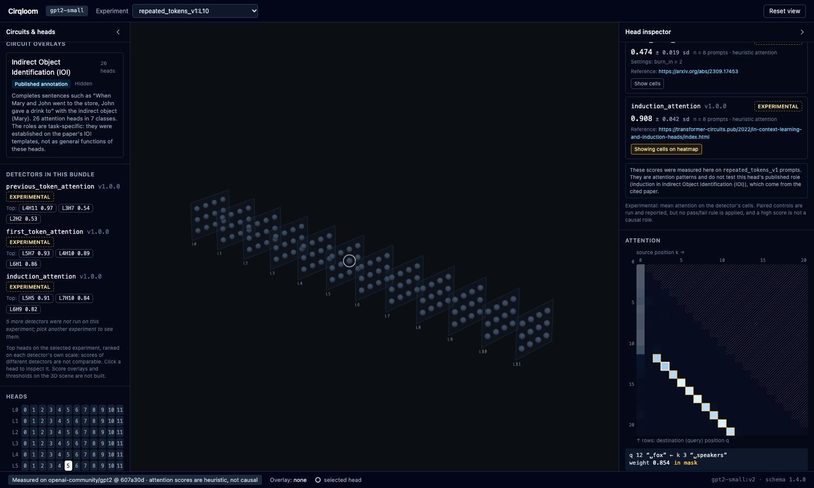
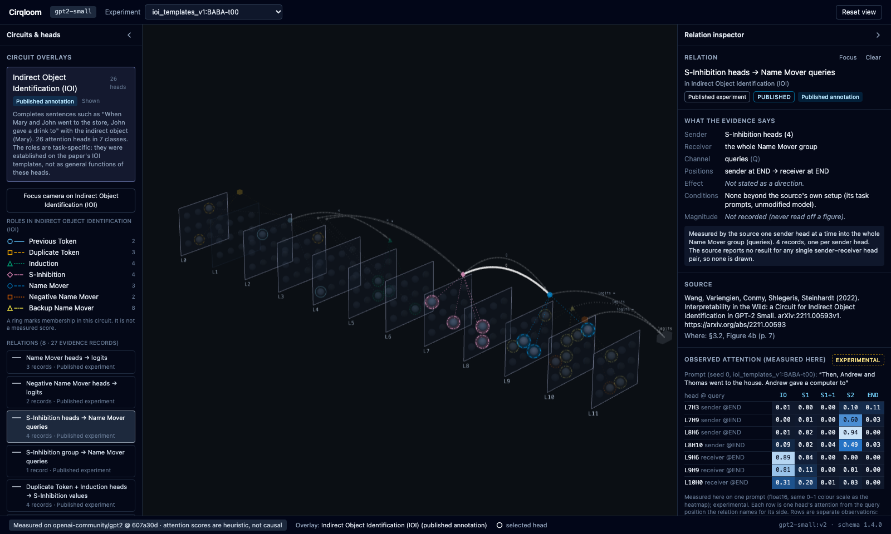
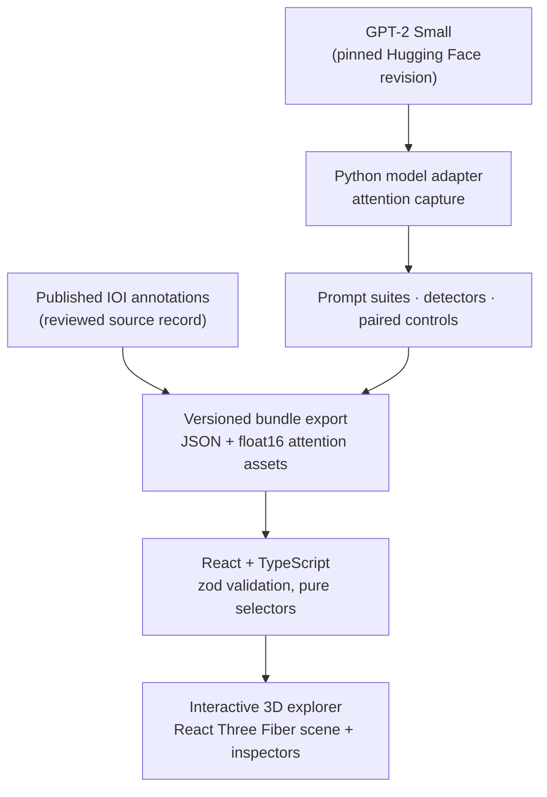

# Cirqloom

**An interactive 3D atlas for exploring transformer attention and mechanistic circuits.**

Cirqloom places GPT-2 Small's 144 attention heads in one navigable 3D scene. It overlays the published Indirect Object Identification (IOI) circuit, and next to each head it shows attention measured on real prompts with paired controls. Every number and every relation says where it comes from. A paper's claim, a measurement made here and a demo fixture are labelled differently, so a reader can tell them apart.

[**Live demo**](https://cirqloom-z8mm.vercel.app/) · [Repository](https://github.com/CG-Brian/cirqloom) · [Roadmap](docs/roadmap.md)

[](https://github.com/CG-Brian/cirqloom/actions/workflows/ci.yml)



## Why Cirqloom?

Mechanistic interpretability work is spread across separate places: attention matrices in notebooks, detector scores in scripts, and circuit diagrams in papers. It is easy to lose track of which statement rests on which evidence. A large attention weight is not a connection between heads, and a high detector score is not a verified role.

Cirqloom puts these in one interactive view and keeps the provenance attached. Published annotations carry their citation and figure. Measured scores carry their prompt suite, sample count, settings and control run. Nothing in the interface claims a causal effect that was not measured.

## Interactive demo

**A head, its scores and its attention.** Select any head in the 3D scene or the keyboard-navigable head list. The inspector shows its detector scores for the chosen experiment (mean ± sd over prompts, n, settings) and the attention heatmap of one stored prompt. "Show cells" outlines the exact cells a score averaged, as exported by the Python pipeline. Here, induction head L5H5 on repeated random tokens attends to the token after each earlier occurrence:



**A published relation next to what was measured here.** Open a relation of the IOI circuit from the list or by clicking its ribbon. The relation inspector gives the paper's claim: sender, receiver, Q/K/V channel, token positions, and the section and figure it comes from. Below it, a separate section shows the attention that the same heads have at those positions on an IOI prompt, labelled as an observation:



## Key capabilities

**Interactive 3D transformer atlas**
- GPT-2 Small as 12 layers × 12 heads, with orbit, pan and zoom, reset, and camera focus on a circuit, a relation or a head.
- Restrained emphasis: circuit members get a thin role ring (colour plus line pattern and marker shape), non-members recede, and selection adds a neutral ring.
- Keyboard-accessible head list and relation list kept in sync with the 3D scene, and a fallback that keeps every panel usable without WebGL.

**Real model measurements**
- Attention captured from GPT-2 Small (`openai-community/gpt2`, pinned revision) through TransformerLens `TransformerBridge`.
- Prompt suites: repeated random tokens (L = 10, 25, 50) and IOI sentences from the paper's templates, each with a paired control (non-repeated tokens; a third name in place of S2).
- Detectors defined as exact boolean masks over attention cells: previous-token, first-token (BOS), induction, and attention between named IOI positions. The masks are exported, and the heatmap draws them.

**Published IOI circuit explorer**
- The circuit of [Wang et al. (2022)](https://arxiv.org/abs/2211.00593): 26 heads in 7 role groups, with 27 sourced relations drawn as 8 evidence-typed ribbons.
- Relations are stored at the granularity the paper measured (head → role group, group → group, head → logits). None is expanded into head pairs the paper did not test.
- Each relation records its channel, positions and figure locator. The import is checked against an independent copy of the paper's tables ([source record](docs/sources/ioi-wang-2022.md)).

**Reproducible research infrastructure**
- A deterministic Python pipeline: the same code, seeds and model revision rebuild a byte-identical bundle.
- Versioned bundle schema (1.4.0), defined in parallel in Pydantic and zod. A cross-language contract test parses the Python output in TypeScript.
- Semantic validators reject a missing provenance record, an edge without an evidence kind, or an unmeasured score serialized as a number.

## Architecture



All analysis runs offline. The Python pipeline writes static bundles to `data/`, and they are committed. The deployed site is static files only: it loads those bundles, validates them in the browser and renders them. It does not run the model, load weights or call a backend. Details: [docs/architecture.md](docs/architecture.md).

## Experimental results and scientific integrity

A representative finding from the committed bundle (`data/bundles/gpt2-small/README.md`) is mean induction attention on repeated random tokens (`repeated_tokens_v1:L50`, 8 prompts) against the paired non-repeated control (`nonrepeated_tokens_v1:L50`):

| Head | Detector | Repeated tokens | Non-repeated control |
| --- | --- | --- | --- |
| L5H5 | `induction_attention` | 0.940 | 0.002 |
| L6H9 | `induction_attention` | 0.918 | 0.002 |
| L7H10 | `induction_attention` | 0.911 | 0.002 |
| L5H1 | `induction_attention` | 0.911 | 0.000 |
| All 144 heads (median) | `induction_attention` | 0.005 | 0.001 |
| L4H11 | `previous_token_attention` | 0.990 | 0.987 |

The induction stripe disappears when nothing repeats. The previous-token pattern of L4H11 stays the same, as expected for a positional pattern. These are **attention-pattern observations**. They show where the heads look, not what the heads write or whether the model depends on them, and every score is labelled `experimental`.

| Evidence | Source | Label in the app |
| --- | --- | --- |
| Measured here | Attention scores computed by this pipeline on GPT-2 Small, with paired controls | "Experimental", with n, settings and control run |
| Published | IOI membership, roles and relations imported from Wang et al. (2022), each with a figure or section locator. Cirqloom did not rerun the paper's experiments. | "Published annotation" / "Published experiment", with citation |
| Synthetic | The demo fixture used by tests (`?bundle=fixture`) | "Demo fixture — not measured model data." |
| Not implemented | Direct logit attribution, weight composition, causal interventions | Not shown |

Methods, controls and caveats: [docs/scientific-methods.md](docs/scientific-methods.md).

## Quickstart

The committed bundles are enough to run the UI. You need no Python and no model weights.

```bash
cd frontend
npm ci
npm run dev
```

Open the URL Vite prints (default http://localhost:5173). Add `?bundle=fixture` to open the synthetic fixture (live: [cirqloom-z8mm.vercel.app/?bundle=fixture](https://cirqloom-z8mm.vercel.app/?bundle=fixture)).

| Action | Control |
| --- | --- |
| Rotate / pan / zoom | Left-drag / right-drag / scroll or pinch |
| Select a head | Click it, or use the head list (arrow keys, Home/End) |
| Clear selection | Esc, or click empty space |

## Reproducing the experiments

The real-model extra downloads the pinned GPT-2 weights (~500 MB) into the Hugging Face cache. A CPU run then takes about 10 seconds.

```bash
python3 -m venv .venv
.venv/bin/pip install -e "analysis[dev,model]"
.venv/bin/python analysis/scripts/build_gpt2_bundle.py
.venv/bin/python analysis/scripts/validate_bundle.py data/bundles/gpt2-small
```

Rebuilding without code changes produces byte-identical files. The bundle's own `README.md` records the environment and every measurement/control comparison. To regenerate the synthetic fixture without weights, run `analysis/scripts/build_fixture_bundle.py`.

## Testing

```bash
# Python (from analysis/, after pip install -e "analysis[dev]")
../.venv/bin/ruff check .
../.venv/bin/pytest                                                      # detector math, schema, IOI import
CIRQLOOM_REAL_MODEL=1 ../.venv/bin/pytest tests/test_gpt2_adapter.py     # optional: real GPT-2

# Frontend (from frontend/)
npm run lint && npm run typecheck
npm test                          # Vitest: selectors, schema parsing, panels
npm run build
npx playwright install chromium   # first time only
npm run e2e                       # Playwright on the real WebGL scene and bundles
npm run e2e:pages                 # the same suite against a production build under /cirqloom/
```

- **Unit tests:** detector masks on toy attention matrices (off-by-one, BOS, second-copy-only induction stripe), aggregation and NaN handling, schema validation, and the IOI import against an independent copy of the paper's tables.
- **Contract tests:** the TypeScript schema parses the Python-generated bundles.
- **Browser tests:** they drive the actual 3D scene. They click heads and ribbons by projecting them with the app's own camera, and they cover selection, heatmaps, masks, relations and focus.
- **CI** runs all of this, except the real-model tests, on every push, and fails if regenerating the fixture changes `data/`.

To recapture the README screenshots from a running app, run `npm run screenshots -- <url>`.

## Deployment

The demo is a static build: `npm run build` writes the app and both bundles to `frontend/dist`.

- **Vercel** builds from `frontend/` at the root path ([`frontend/vercel.json`](frontend/vercel.json), [ADR 0007](docs/adr/0007-vercel-deployment.md)).
- **GitHub Pages** builds for `/cirqloom/` and runs the browser suite before deploying ([ADR 0006](docs/adr/0006-github-pages-deployment.md)).

## Limitations and future work

- Attention measurements are not causal evidence. A high score is not a verified role.
- The published IOI findings are imported, not independently reproduced.
- Direct logit attribution, weight composition and causal interventions are not implemented yet.
- Only GPT-2 Small is supported. Touch and trackpad gestures have not been tested on real devices.

Next come the reconstruction of the Induction circuit (weight composition with baselines, copying analysis), the copy-suppression mechanism around L10H7, and per-detector overlays. See the [roadmap](docs/roadmap.md).

## References and documentation

- [Technical specification](docs/spec.md): scope, scientific rules, data contract, acceptance criteria
- [Scientific methods](docs/scientific-methods.md) · [Architecture](docs/architecture.md) · [UI guidelines](docs/ui-guidelines.md) · [Roadmap](docs/roadmap.md)
- [Source record: IOI circuit, Wang et al. (2022)](docs/sources/ioi-wang-2022.md)
- ADRs: [0001 static bundles and parallel schemas](docs/adr/0001-static-bundle-and-parallel-schemas.md) · [0002 measured bundles](docs/adr/0002-measured-bundles-schema-1-1.md) · [0003 detector masks](docs/adr/0003-detector-masks-schema-1-2.md) · [0004 evidence-typed circuit edges](docs/adr/0004-circuit-edges-schema-1-3.md) · [0005 IOI prompts and positions](docs/adr/0005-ioi-prompts-and-positions-schema-1-4.md) · [0006 GitHub Pages](docs/adr/0006-github-pages-deployment.md) · [0007 Vercel](docs/adr/0007-vercel-deployment.md)

Papers:
- Wang et al. (2022). [Interpretability in the Wild: a Circuit for Indirect Object Identification in GPT-2 Small](https://arxiv.org/abs/2211.00593).
- Olsson et al. (2022). [In-context Learning and Induction Heads](https://transformer-circuits.pub/2022/in-context-learning-and-induction-heads/index.html).
- Elhage et al. (2021). [A Mathematical Framework for Transformer Circuits](https://transformer-circuits.pub/2021/framework/index.html).

Built with React, TypeScript, Vite, React Three Fiber, zod and Zustand, and with Python, PyTorch, TransformerLens and Pydantic. Tested with Node 26 and Python 3.14.
